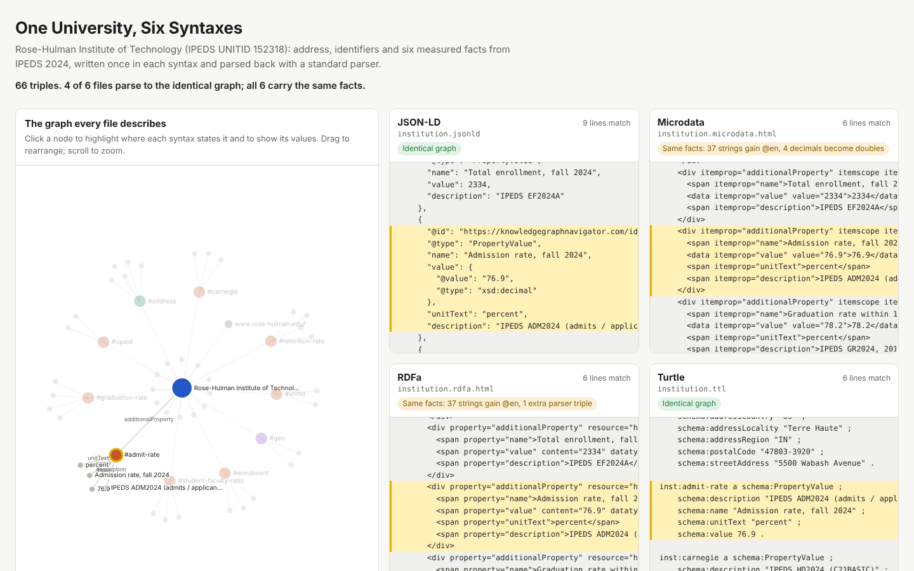

# Experiment 1: One University, Six Syntaxes

Rose-Hulman Institute of Technology, written six times with the same facts each time: JSON-LD, Microdata, RDFa, Turtle, N-Triples and JSONL. Every file is parsed back with a standard parser and compared with a reference graph.

**Question:** If the facts are the same, is the graph the same?

**Answer:** The facts are the same in all six. The graph is identical in four. Microdata and RDFa produce the same facts with slightly different literals, because HTML has its own rules about language and numbers.



Open [`viz/index.html`](viz/index.html) in a browser to explore it. Click any node to highlight where each syntax states it.

## Results

Reference graph: 66 triples about one institution (name, 11 aliases, website, address, coordinates, two identifiers and six IPEDS measures).

| Format | File | Triples | Identical graph | Same facts |
|---|---|---|---|---|
| JSON-LD | [`institution.jsonld`](output/institution.jsonld) | 66 | yes | yes |
| Microdata | [`institution.microdata.html`](output/institution.microdata.html) | 66 | no | yes |
| RDFa | [`institution.rdfa.html`](output/institution.rdfa.html) | 67 | no | yes |
| Turtle | [`institution.ttl`](output/institution.ttl) | 66 | yes | yes |
| N-Triples | [`institution.nt`](output/institution.nt) | 66 | yes | yes |
| JSONL | [`institutions.jsonl`](output/institutions.jsonl) | 66 | yes | yes |

"Same facts" compares literals by lexical value only, ignoring datatypes and language tags, and drops triples that a parser adds about itself. The full breakdown is in [`output/verify-report.md`](output/verify-report.md). The same check passes for all 45 institutions in the sample.

## What the differences show

**1. HTML formats inherit the page's language.** Both HTML pages declare `<html lang="en">`, as almost every real page does. RDFa and Microdata both apply that language to text values, so 37 plain strings such as `"Terre Haute"` become `"Terre Haute"@en`. The JSON-LD file carries no language because it doesn't declare one with `@language`. A site that publishes the same facts in JSON-LD and in Microdata is therefore publishing two slightly different graphs.

**2. Microdata has no way to say "decimal."** The W3C Microdata to RDF rules turn a numeric `<data value="76.9">` into an `xsd:double`. Integers like 2334 come through as `xsd:integer`, but the four decimal values (admission rate, graduation rate, latitude and longitude) change type. RDFa and Turtle can state `xsd:decimal` explicitly.

**3. JSON-LD needs help with decimals too.** A bare JSON number with a fraction, like `76.9`, becomes an `xsd:double` in JSON-LD as well. To keep it a decimal, the JSON-LD file writes it as a typed value: `{"@value": "76.9", "@type": "xsd:decimal"}`. That's why the JSON-LD file matches exactly and the Microdata file doesn't.

**4. RDFa parsers report on themselves.** The RDFa processor adds one triple, `rdfa:usesVocabulary <https://schema.org/>`, recording the vocabulary the page declared. It's metadata about the parse, not a fact about the university.

**5. JSONL is JSON-LD, one document per line.** `institutions.jsonl` holds all 45 institutions, one complete JSON-LD document per line. The Rose-Hulman line parses to exactly the same graph as the pretty-printed JSON-LD file. The format exists for batch pipelines and LLM training and retrieval workflows, where streaming one record per line matters more than readability.

## Run it

Requires Python 3.10 or later.

```bash
cd experiments/01-same-facts-six-syntaxes
python -m venv .venv && source .venv/bin/activate
pip install -r requirements.txt

python build.py      # writes the six files to output/
python verify.py     # parses them back and compares (exit code 0 = same facts)
python viz.py        # builds viz/index.html
```

To try a different institution, pass its UNITID to each script, for example `python build.py 236948` for the University of Washington. UNITIDs are listed in [`data/institutions-v1.0.csv`](../../data/institutions-v1.0.csv).

## How it works

- **`build.py`** reads three CSVs from [`/data`](../../data) and builds one data model. Six small writers turn that model into the six syntaxes. The Turtle and N-Triples files are serialized by rdflib. The JSON-LD, Microdata and RDFa files are written by hand so they look like markup a person would publish.
- **`verify.py`** parses each file with a standard parser: rdflib for JSON-LD, Turtle and N-Triples, and pyRdfa for RDFa. rdflib has no Microdata parser, so the script includes a short one that follows the [W3C Microdata to RDF](https://www.w3.org/TR/microdata-rdf/) rules for the markup used here. It then compares each graph with the reference graph, which is built directly from the model without any parsing.
- **`viz.py`** fills `viz_template.html` with the six files and the graph and writes `viz/index.html`. The page loads D3 7.9.0 from cdnjs.

## Modeling notes

- **IRIs.** Each institution gets an identifier like `https://knowledgegraphnavigator.com/id/ipeds/152318`, with fragment IRIs (`#address`, `#admit-rate`) for the nodes inside it. These are stable identifiers for the experiment and are not meant to resolve.
- **Where the measures go.** schema.org has no `numberOfStudents` or `admissionRate` property for `CollegeOrUniversity`. The six IPEDS measures are attached as `additionalProperty` → `PropertyValue`, which is valid because `EducationalOrganization` is also a `CivicStructure`, and therefore a `Place`. Experiment 4 compares this with other ontologies.
- **Identifiers are strings.** The OPE ID `00183000` has to keep its leading zeros, so identifiers are never typed as numbers.
- **Aliases are as reported.** The 11 alternate names come straight from the IPEDS `IALIAS` field, including the ambiguous "RPI." Experiment 10 covers matching names and IDs to the right entity.

## Data

NCES IPEDS, 2024 collection year: HD2024, EF2024A, EF2024D, ADM2024 and GR2024. See the dataset [README](../../data/README.md) for sources, sampling and known gaps.
