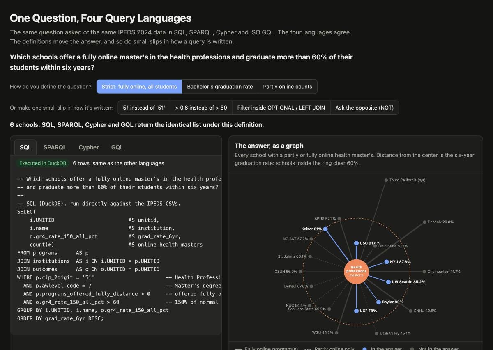

# Experiment 2: One Question, Four Query Languages

> Which schools offer a fully online master's in the health professions and graduate more than 60% of their students within six years?

This experiment asks that question four ways against the same IPEDS 2024 data, in SQL, SPARQL, Cypher and ISO GQL, and runs each one on a real engine.

**Answer:** Six schools. All four languages return the identical list.

**The bigger finding:** the language never changed the answer, but the definitions did. Small, defensible changes to what "fully online" and "six-year graduation rate" mean moved the answer from 6 schools to 5 or to 10, and all four languages moved together every time.

[](https://knowledgegraphnavigator.github.io/kgn-ipeds-experiments/experiments/02-one-question-four-query-languages/viz/)

**[Open the interactive visualization](https://knowledgegraphnavigator.github.io/kgn-ipeds-experiments/experiments/02-one-question-four-query-languages/viz/)** to explore it. (GitHub shows `viz/index.html` as source code; the link above runs it.) Switch the definition, or try one of the small slips, to see which query lines change and which schools join or leave the answer.

## Results

| Definition | Schools | SQL | SPARQL | Cypher | GQL |
|---|---|---|---|---|---|
| **Strict:** fully online programs; all-student six-year rate | 6 | ✓ | ✓ | ✓ | ✓ |
| Bachelor's-seeking students' six-year rate instead | 5 | ✓ | ✓ | ✓ | ✓ |
| Partly online programs also count | 10 | ✓ | ✓ | ✓ | ✓ |

✓ = same list of schools, rates and program counts as the other languages. Full tables are in [`output/results.md`](output/results.md) and [`output/gql-results.md`](output/gql-results.md).

Under the strict definition: University of Southern California (91.8%), New York University (87.6%), University of Washington-Seattle (85.2%), Baylor University (80.0%), University of Central Florida (78.0%) and Keiser University-Ft Lauderdale (61.0%).

## Where the answer moves

**1. Which graduation rate?** IPEDS reports a six-year (150% of normal time) rate for all degree- and certificate-seeking students and a separate one for bachelor's-seeking students. Keiser's rate is 61.0% for all students and 57.7% for bachelor's-seeking students. Pick the second and Keiser drops out.

**2. What counts as "online"?** IPEDS separates programs offered completely through distance education from programs with only some distance-education component. Counting both adds four schools: Ohio State, San Jose State, DePaul and St. John's. None of them offers a health master's fully online in this data. The dataset README also notes that the "some distance" field's meaning was inferred and should be checked against the IPEDS dictionary.

**3. What about missing data?** Touro University California offers online health master's programs but has no graduation rate, because IPEDS doesn't collect one for graduate-only institutions. All four languages leave it out silently: SQL because `NULL > 60` isn't true, SPARQL because the graph has no rate triple to match, and Cypher and GQL because a null comparison filters the row. A question phrased as "schools that *don't* clear 60%" would leave Touro out too, which may not be what the person asking expects.

## Small slips, big discrepancies

The definitions above are deliberate choices. These are accidents: typo-sized changes to how the strict question is written, each one a mistake a careful analyst could make. Every one was run in all four languages.

| Slip | SQL | SPARQL | Cypher | GQL |
|---|---|---|---|---|
| None (the strict question) | 6 | 6 | 6 | 6 |
| Write the CIP code as `51` instead of `'51'` | 6 | **0** | 6 | **0** |
| Write the threshold as `> 0.6` instead of `> 60` | 13 | 13 | 13 | 13 |
| Put the rate condition inside an outer join or `OPTIONAL` | 14 | 14 | n/a | n/a |
| Ask the opposite: which schools do *not* clear 60%? | 7 | **8** | 7 | error |

**1. One missing pair of quotes.** CIP codes are text (`'51'`, and `'01'` keeps its leading zero). DuckDB and Kùzu quietly convert the number 51 to text and still return the right six schools. SPARQL compares RDF terms exactly, so the integer `51` never matches the string `"51"`, and GraphLite compares types strictly too. Both return zero rows and no error. An empty result looks like an answer.

**2. Percent or proportion?** IPEDS stores rates as percents from 0 to 100. Writing `> 0.6`, the habit from tools that store rates as proportions, keeps every school that has a rate: 13 instead of 6. All four languages make this mistake identically, because the data is wrong for the query, not the language.

**3. A filter in the wrong place.** In SQL, moving the rate condition from `WHERE` into a `LEFT JOIN ... ON` clause, or in SPARQL, into an `OPTIONAL { }` block, changes what it means. The condition no longer removes schools. It only decides whether their rate gets attached, so all 14 schools with a fully online health master's come back. Eight of them have a blank rate: the seven below 60%, plus Touro, which has no rate at all. The same mistake can't be made in the Cypher and GQL versions, because the rate is a property on the school's node rather than a separate table or set of triples. That's a modeling difference worth noticing.

**4. Negation meets missing data.** Asked the opposite way, each language's usual idiom gives a different answer. SQL and Cypher write `NOT (rate > 60)`; for Touro, which has no rate, that's `NOT (unknown)`, still unknown, so Touro is dropped: 7 schools. SPARQL's usual idiom, `FILTER NOT EXISTS { ... ?r > 60 }`, asks whether a qualifying rate exists, finds none, and keeps Touro: 8 schools. GraphLite stops with an error ("NOT operator requires boolean operand") instead of treating the result as unknown.

The slips that fail loudly, like GraphLite's error, are the easy ones. The dangerous ones return a plausible-looking answer with no warning: zero rows, or a longer list with blanks in it.

## The four queries

| | Data model | Engine | Code lines* | Joins written as |
|---|---|---|---|---|
| [SQL](queries/question.sql) | Three tables, straight from the CSVs | DuckDB 2.0 | 14 | Key equality (`ON i.UNITID = p.UNITID`) |
| [SPARQL](queries/question.rq) | RDF: schema.org plus a small `kgn:` vocabulary | rdflib 7.6 | 17 | Shared variables (`?school`) |
| [Cypher](queries/question.cypher) | Labeled property graph | Kùzu 0.11.3 | 9 | Arrows in the pattern |
| [GQL](queries/question.gql) | Same property graph | GraphLite 0.0.1 | 10 | Arrows in the pattern |

\*Non-comment lines.

The graph languages express the joins as the shape of the pattern: `(Institution)-[:OFFERS]->(Offering)-[:IN_FAMILY]->(CipFamily)`. SQL states each join as a key comparison. SPARQL sits in between: it joins wherever two triple patterns share a variable, so it's shorter on joins and longer on vocabulary.

### GQL on GraphLite

ISO/IEC 39075:2024 (GQL) is the ISO standard query language for property graphs, published in 2024. The GQL query runs on [GraphLite](https://github.com/GraphLite-AI/GraphLite), an open-source embedded GQL database written in Rust. For this question the GQL and Cypher queries are identical except for one line: GQL's explicit `GROUP BY` clause. Cypher has no `GROUP BY`; it groups implicitly by the non-aggregated columns in `RETURN`.

GraphLite is at version 0.0.1, and it shows:

- **Parts of the standard don't parse yet.** The `FILTER` and `LET` statements and `WHERE` predicates inside a node pattern, such as `(f:CipFamily WHERE f.code = '51')`, are all valid GQL but fail in GraphLite. The query sticks to `MATCH ... WHERE`, which the standard also allows.
- **Loading is slow.** Edges can only be created between nodes found with `MATCH`, and there are no indexes, so each edge statement scans the graph. `run_gql.py` therefore loads every institution and CIP family but only the health-professions (CIP 51) offerings by default: 1,062 nodes and 1,958 edges, in a few seconds. That's everything the question can touch. `--full` loads the complete graph of 8,117 nodes and 16,068 edges, which took about seven minutes when this experiment was built and returns the same answers.
- **Smaller quirks.** Statements longer than a few thousand characters fail in the lexer, so nodes are inserted in batches. Column aliases (`AS unitid`) are ignored in result headers.

## Run it

Requires Python 3.10 or later.

```bash
cd experiments/02-one-question-four-query-languages
python -m venv .venv && source .venv/bin/activate
pip install -r requirements.txt

python build.py   # optional: prints the size of each data store
python run.py     # runs SQL, SPARQL and Cypher under all three definitions (exit 0 = all agree)
python viz.py     # builds viz/index.html
```

`run.py` takes about two seconds. It builds the Kùzu database in `.work/`, which isn't committed.

To run the GQL query too, install the GraphLite CLI with Rust's `cargo` (get Rust from [rustup.rs](https://rustup.rs) or `brew install rust` on a Mac), then run `run_gql.py` after `run.py` and before `viz.py`:

```bash
cargo install graphlite-cli   # builds the `graphlite` binary, about two minutes
python run_gql.py             # loads the graph into GraphLite and runs question.gql (exit 0 = matches)
python viz.py                 # rebuild so the GQL tab shows its result
```

## How it works

- **`build.py`** loads `institutions`, `outcomes` and `programs` from [`/data`](../../data) into three stores. SQL runs on DuckDB tables read straight from the CSVs. SPARQL runs on an RDF graph of 64,588 triples: schools are `schema:CollegeOrUniversity`, program offerings are `schema:EducationalOccupationalProgram` with a `schema:provider`, and IPEDS-specific fields such as CIP family and distance-education counts use a small `kgn:` vocabulary. Cypher runs on a Kùzu property graph of 8,117 nodes and 16,068 relationships.
- **`run.py`** runs the three query files, normalizes the rows and checks that they match. It then applies each alternative definition, and each small slip, as a text edit to every query and runs them again. The edits are listed in the `VARIANTS` and `TRAPS` blocks at the top of the file. Errors are recorded as results.
- **`run_gql.py`** creates a GraphLite database in `.work/graphlite`, loads the property graph, runs `question.gql` under all three definitions and the four slips through the GraphLite console and compares the rows with the other languages.
- **`viz.py`** writes `viz/index.html` from `viz_template.html`, the query texts and the results.

## Modeling notes

- **"Program" means a CIP code at an award level.** IPEDS reports completions and program counts by CIP code and award level, not by named program. "3 online health master's" means three six-digit CIP codes in family 51 with at least one fully online master's program.
- **Missing values stay missing.** When IPEDS has no value, the RDF graph has no triple and the property graph stores a null. Nothing is filled with a zero.
- **About Kùzu.** Kùzu's developers stopped work on the project in October 2025, and 0.11.3 is its final release. It still installs from PyPI and runs this experiment. The Cypher query uses only core syntax, so it should also run on Neo4j or another Cypher database with the same schema.

## Data

NCES IPEDS, 2024 collection year: HD2024, GR2024 and C2024_A/C2024DEP (completions and programs offered). See the dataset [README](../../data/README.md) for sources, sampling and known gaps.
