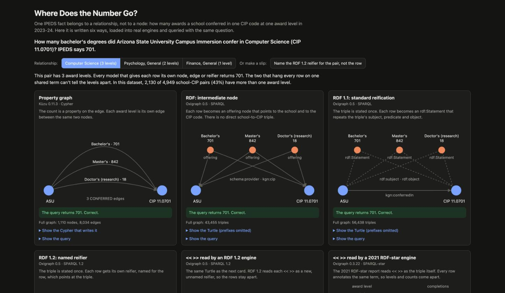

# Experiment 3: Where Does the Number Go? RDF vs. Property Graphs

> In 2023-24, Arizona State University Campus Immersion conferred 701 bachelor's degrees in Computer Science (CIP 11.0701).

That 701 doesn't belong to the school or to the program. It belongs to the relationship between them, and only at one award level: the same school and CIP code also conferred 842 master's degrees and 18 research doctorates. Every one of the 8,034 rows in [`programs-v1.0.csv`](../../data/programs-v1.0.csv) is a fact like this.

This experiment writes those 8,034 facts in five graph models, loads each into a real engine, and asks every model the same two questions. It also runs one Turtle file in two engines that read it differently.

**The answer:** every model that gives each row its own edge, node or reifier gets both questions right. The two that hang several rows on one shared term don't. One of those is a slip in RDF 1.2. The other is the 2021 RDF-star reading of `<< >>`, which several triplestores implemented, applied to a file RDF 1.2 reads correctly.

[](https://knowledgegraphnavigator.github.io/kgn-ipeds-experiments/experiments/03-rdf-vs-property-graph/viz/)

**[Open the interactive visualization](https://knowledgegraphnavigator.github.io/kgn-ipeds-experiments/experiments/03-rdf-vs-property-graph/viz/)** to switch between relationships with one, two and three award levels. (GitHub shows `viz/index.html` as source code; the link above runs it.)

## The five models

The same row, ASU x CIP 11.0701 at the bachelor's level, in each model. Full examples for all three award levels are in [`output/sample/`](output/sample/).

**Property graph** (Kùzu, Cypher). The count is a property on the edge. Three award levels are three `CONFERRED` edges between the same two nodes.

```cypher
(i:Institution {unitid: '104151'})-[:CONFERRED {awardLevelCode: 5, completions: 701}]->(c:Cip {code: '11.0701'})
```

**RDF with an intermediate node** (Oxigraph, SPARQL). RDF triples can't carry properties, so the relationship becomes a node: one "offering" per row, pointing to the school and the CIP code. There's no direct school-to-CIP triple.

```turtle
offering:104151-11.0701-5 a schema:EducationalOccupationalProgram ;
    schema:provider ipeds:104151 ;
    kgn:cip cip:11.0701 ;
    kgn:awardLevelCode 5 ; kgn:completions 701 .
```

**RDF 1.1 standard reification.** The school-to-CIP triple is stated once. Each row becomes an `rdf:Statement` that repeats the triple's subject, predicate and object, then carries the count. It's the most verbose model.

```turtle
ipeds:104151 kgn:conferredIn cip:11.0701 .
offering:104151-11.0701-5 a rdf:Statement ;
    rdf:subject ipeds:104151 ; rdf:predicate kgn:conferredIn ; rdf:object cip:11.0701 ;
    kgn:awardLevelCode 5 ; kgn:completions 701 .
```

**RDF 1.2 with a named reifier.** The triple is stated once. Each row gets a reifier, named for the row, that points at the triple with `rdf:reifies`. The `~ name {| ... |}` annotation syntax writes both in one statement.

```turtle
ipeds:104151 kgn:conferredIn cip:11.0701 ~ offering:104151-11.0701-5
    {| kgn:awardLevelCode 5 ; kgn:completions 701 |} .
```

**RDF-star annotation syntax.** The triple is stated once, and each row annotates `<< subject predicate object >>`. This is the file that two engines read differently.

```turtle
ipeds:104151 kgn:conferredIn cip:11.0701 .
<< ipeds:104151 kgn:conferredIn cip:11.0701 >> kgn:awardLevelCode 5 ; kgn:completions 701 .
<< ipeds:104151 kgn:conferredIn cip:11.0701 >> kgn:awardLevelCode 7 ; kgn:completions 842 .
```

## Results

Q1 asks for ASU's bachelor's degrees in CIP 11.0701 (IPEDS: 701). Q2 totals completions by award level across all 8,034 rows (IPEDS: 451,677). Every model was loaded with all 8,034 rows. Full numbers are in [`output/results.md`](output/results.md).

| Model | Engine | Full graph | Q1 | Q2 total |
|---|---|---|---|---|
| Property graph: count on the edge | Kùzu 0.11.3 | 1,110 nodes, 8,034 edges | **701** ✓ | **451,677** ✓ |
| RDF: intermediate node | Oxigraph 0.5 | 43,455 triples | **701** ✓ | **451,677** ✓ |
| RDF 1.1: standard reification | Oxigraph 0.5 | 56,438 triples | **701** ✓ | **451,677** ✓ |
| RDF 1.2: named reifier per row | Oxigraph 0.5 | 32,336 triples | **701** ✓ | **451,677** ✓ |
| `<< >>` file, read as RDF 1.2 | Oxigraph 0.5 | 32,336 triples | **701** ✓ | **451,677** ✓ |
| `<< >>` file, read as RDF-star 2021 | Oxigraph 0.3.22 | 23,949 triples | 18, 701, 842 ✗ | 1,061,729 ✗ |
| Slip: RDF 1.2 reifier named for the pair | Oxigraph 0.5 | 28,898 triples | 18, 701, 842 ✗ | 1,061,729 ✗ |

All four RDF graphs also share 3,285 triples that name the 45 schools and 1,065 CIP codes.

## Where the number goes wrong

**One Turtle file, two meanings.** The 2021 RDF-star Community Group report treats `<< s p o >>` as a *quoted triple*: a single term identified only by its subject, predicate and object. All three ASU rows annotate the same term, so it ends up with three award levels and three counts and nothing to pair them. Ask for the bachelor's count and you get all three: 18, 701 and 842. RDF 1.2 reads the same `<< >>` as "a new, unnamed reifier," so each row gets its own blank node and the pairing survives.

The damage scales with the data. In this sample, 2,130 of 4,949 school-CIP pairs (43%) have more than one award level. Under the 2021 reading, total completions come out at 1,061,729 instead of 451,677. Bachelor's degrees rise from 205,364 to 296,747, and research doctorates from 5,298 to 81,129, because each doctorate row picks up its pair's bachelor's and master's counts. Duplicate values also collapse: in 320 pairs, two award levels share the same count, and the quoted triple can only hold it once.

**The same mistake in RDF 1.2.** A reifier is just a name. Name it for the row (`offering:104151-11.0701-5`) and everything works. Name it for the pair (`offering:104151-11.0701`), which looks reasonable if you think of the reifier as "the relationship," and every row lands on it again. The results match the 2021 reading exactly.

**When nothing goes wrong.** If a school offers a CIP code at only one award level, every model returns the right answer, including the two broken ones. ASU's Finance program (CIP 52.0801, 427 bachelor's, no other levels) is an example. That's why this problem is easy to miss in testing.

## What each model costs

- **The property graph is the most direct.** The count sits where it belongs, on the edge, and the query reads like the question. The trade-off is everything outside the graph: property graphs have no standard way to share identifiers or vocabularies across systems, which is the job RDF was built for.
- **The intermediate node is the classic RDF answer, and it works everywhere.** It costs a node per row and drops the direct school-to-CIP link, so "which CIP codes does ASU offer?" becomes a two-hop query. It's also the model Experiment 2 used.
- **Standard reification works but nobody enjoys it.** It's the largest graph here (56,438 triples), and every query has to restate subject, predicate and object.
- **RDF 1.2 reifiers combine the two.** The direct triple stays, and each row gets its own node. A named reifier is essentially the intermediate node with a pointer back to the triple it describes.

## Run it

Requires Python 3.10 or later.

```bash
cd experiments/03-rdf-vs-property-graph
python -m venv .venv && source .venv/bin/activate
pip install -r requirements.txt

python build.py   # optional: writes the Turtle files and prints their sizes
python run.py     # loads every model and runs both questions (exit 0 = all correct models agree with IPEDS)
python viz.py     # builds viz/index.html
```

`run.py` takes about two seconds. Generated graphs and the Kùzu database go to `.work/`, which isn't committed.

The 2021 RDF-star run needs an older Oxigraph, which can't share an environment with the current one. Run it in a second environment after `run.py`, then rebuild the page:

```bash
python -m venv .venv-rdfstar && source .venv-rdfstar/bin/activate
pip install -r requirements-rdfstar-2021.txt
python run_rdfstar_2021.py   # writes output/rdfstar-2021.json
deactivate && source .venv/bin/activate
python run.py && python viz.py
```

## How it works

- **`build.py`** reads the programs and institutions CSVs and writes each RDF model as Turtle (`.work/*.ttl`) plus one example relationship per model in `output/sample/`. It also builds the Kùzu property graph.
- **`queries/q1/`** and **`queries/q2/`** hold the two questions for each model: Cypher for the property graph, SPARQL for the RDF models. The `<< >>` file and the RDF-star 2021 run share `star.rq`, and the slip shares `reifier.rq`.
- **`run.py`** loads every model, runs both queries plus Q1 for the three example relationships, and compares the answers with totals computed straight from the CSV.
- **`run_rdfstar_2021.py`** loads the same `star.ttl` into Oxigraph 0.3.22 and runs the same queries.
- **`viz.py`** writes `viz/index.html` from `viz_template.html` and the results.

## Notes

- **Engines.** Oxigraph implemented the 2021 RDF-star report up to version 0.4 and switched to RDF 1.2 in 0.5, dropping quoted triples in subject position. That makes it a clean way to run one file under both readings. Other triplestores implemented RDF-star on their own schedules; check how yours reads `<< >>` before relying on it.
- **Standards status.** RDF 1.2 Concepts was a W3C Candidate Recommendation as of its April 2026 snapshot, not yet a final Recommendation. ISO GQL (ISO/IEC 39075:2024) standardized property graph queries in 2024, and its edges carry properties the same way Kùzu's do.
- **About Kùzu.** Kùzu's developers stopped work on the project in October 2025, and 0.11.3 is its final release. It still installs and runs this experiment. The Cypher here is core syntax and should run on other Cypher databases with the same schema.
- **Award levels.** Codes follow IPEDS AWLEVEL: 5 is bachelor's, 7 master's, 17 research or scholarship doctorate. CIP titles in the visualization come from the NCES CIP 2020 list; the dataset leaves `cip_title` blank.

## Data

NCES IPEDS, 2024 collection year: C2024_A (completions by CIP code and award level, awards from July 2023 to June 2024) and HD2024. See the dataset [README](../../data/README.md) for sources, sampling and known gaps.
